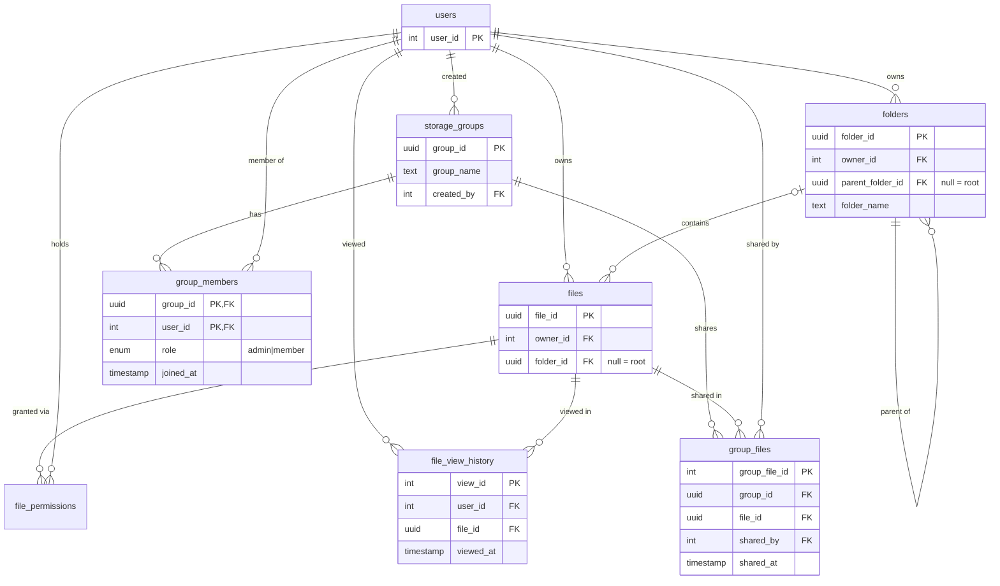

# Database

Postgres via Prisma (`prisma/schema.prisma`, migrations in `prisma/migrations`). File *content* is not in the
database: it lives in the storage backend under the file's uuid (`src/files/storage.ts`). Activity and auth logs
live in MongoDB and are not part of this schema.

## ER diagram

## Folders

- `files.folder_id` is nullable: existing files and root-level uploads have `NULL`.
- Sibling names are unique **per owner, case-insensitively** (policy: a second "Photos" in the same place is a 409).
  Enforced by two partial unique indexes written by hand in the migration (`folders_owner_parent_name_key`,
  `folders_owner_root_name_key`), because Prisma cannot express `lower(name)` or the nullable-parent case. Prisma
  does not manage these, so keep them when editing that migration. File names are not unique, as before.
- `folders_not_own_parent` is a CHECK against a folder being its own parent. Longer cycles are rejected by the
  service (moves run under a per-owner advisory lock so two concurrent moves cannot create one).
- Foreign keys to parent/owner/files are `RESTRICT`; deleting a folder is done by the service, which removes the
  whole subtree (deepest first) and its files in one transaction, then the stored blobs.

## Recently viewed

`file_view_history` has one row per `(user_id, file_id)` (unique), `viewed_at` is bumped on every explicit open.
Index `(user_id, viewed_at DESC)` serves the list. Rows cascade away when the file or user is deleted. Listing also
filters on *current* read access, so files you lost access to disappear without deleting history.

## Groups

- `group_members` has composite PK `(group_id, user_id)`: no duplicate memberships. Index on `user_id`.
- `group_files` links an existing `files` row to a group, unique on `(group_id, file_id)`. One file can be in many
  groups and no content is copied. Group uploads create a normal file owned by the uploader (so it counts toward
  *their* quota) plus the link, in one transaction.
- Group membership grants **READ only**. Delete/ownership still come from `files.owner_id` / `file_permissions`.
- Removing a member deletes only their `group_members` row; files they shared stay linked. Deleting a group
  cascades to its members and links, never to the files.
- Rules enforced in the service (under a per-group advisory lock): at least one admin must remain; only admins add,
  remove, promote or demote others; any member can leave.
